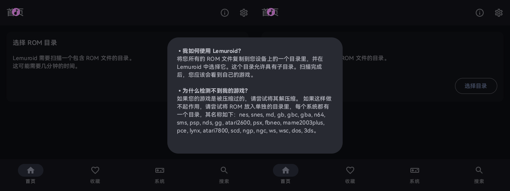
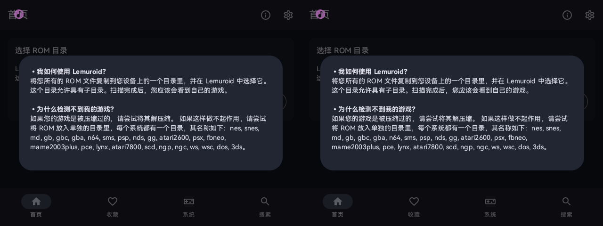
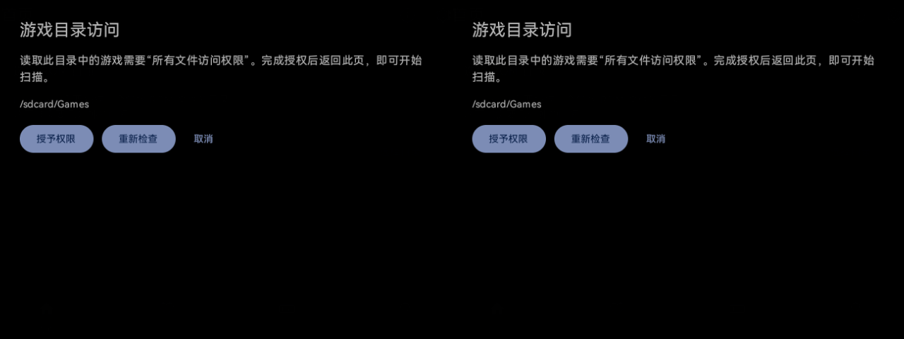
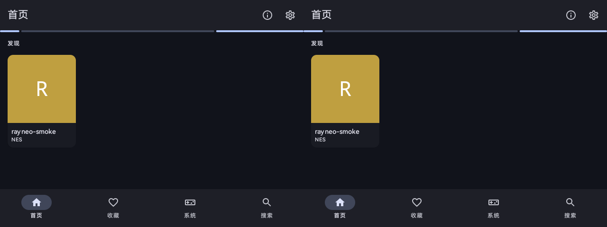

# RayNeo migration validation — 2026-09-09

The user reports that the March adaptation reached an initial working state. The device has since been reflashed, so installation, permissions and ROM directory presence were verified afresh.

## Build and source

- Upstream `53752bf2`, versionCode 252, versionName 1.17.0; cores at the upstream-pinned `fee2e824`.
- The merged pre-fix adaptation built successfully. Final `freeDynamicDebug` build, application Kotlin formatting check and Android lint completed successfully.
- Seven JVM storage boundary tests passed: denied access, retry after grant, exactly-once selection, existing ROM preservation, empty directory, a file occupying the requested path, failed creation and failed listing (the retry test covers two related conditions).
- Eight offline device-probe tests passed, and both the maintained and installed skill validated.
- APK package: `com.swordfish.lemuroid.debug`, version `1.17.0-DEBUG`.
- Signing certificate SHA-256: `ce3ebf1d972c09583470e184d9b86edd20eb4679fedc632d31ac9f58e8741fc8`, matching the March APK.
- APK SHA-256: `619b96bff4bb6b6367dd9495bab77b33d13a784f0eacc561ac20b0965114effa`.

## Device observations

The connected X3 Pro reports ARGF20, API 32, 1280×480 and density 160. Before installation it had no Lemuroid package and no `/sdcard/Games`. DocumentsUI is absent; the per-app all-files Settings activity exists.

- Installed the updated APK and started its home page.
- Reproduced the original help dialog spanning the eye boundary. The common dual-eye dialog now renders the full text in each eye. It keeps one UI composition and duplicates the View drawing.
- Verified a readable storage recovery page in both eyes. A denied Settings return left directory preferences uncreated and `/sdcard/Games` absent.
- Enabling the system all-files switch and returning to the app created `/sdcard/Games` and saved it as the legacy directory.
- Applied the documented ADB all-files appop and retained the retry flow. UI accessibility of the system Settings page is separate from Lemuroid: that system window is still laid out across the physical display.
- A self-authored 24 KiB NROM smoke-test file was copied into the directory and recognized by the library as `rayneo-smoke` / NES. This establishes directory enumeration and indexing beyond an appop query.

The device's ADB transport can drop during load. The user's selected WLAN/TCP method was used, with the same device identity checked after reconnect. Network credentials and raw device inventories are excluded from this repository.

## Visual evidence

Original help dialog:

Adapted help dialog:

Storage recovery page:

Indexed test file:

## Remaining hardware acceptance

Rendered screenshots do not establish physical temple gesture behavior, actual Bluetooth controller binding, eye-to-eye phase alignment or performance across emulator cores. The source changes route the context menu and binding dialogs through the shared modal entry point; those interactions require their own device checks. No universal 640×480 virtual-display solution or performance claim is made by this migration.
