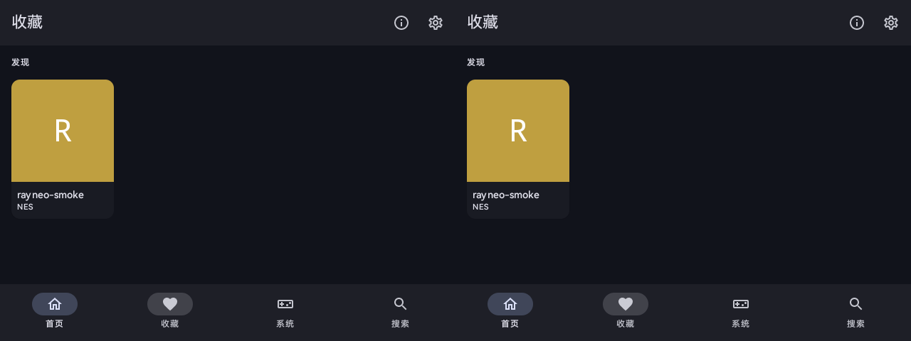
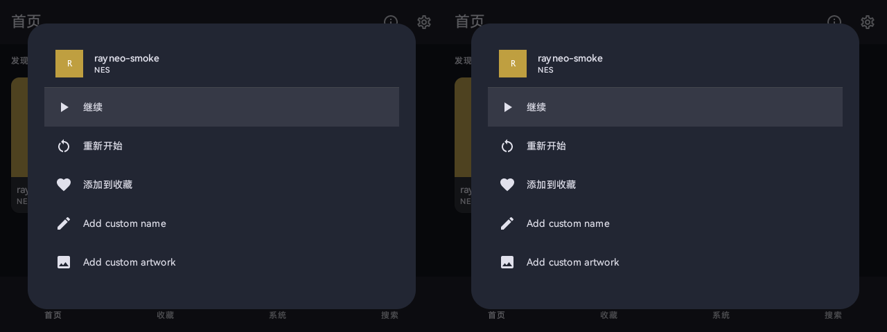

# RayNeo X3 Pro update — 2026-10-09

## Version and delivery

- Upstream: `Swordfish90/Lemuroid` master `93e321d0`; pinned cores remain `fee2e824`.
- App: `1.17.0-rayneo.2`, versionCode `252`, launcher label **Lemuroid**.
- Package: `com.swordfish.lemuroid.debug`. The existing debug signing certificate is retained for data-preserving replacement installs.
- APK: `Lemuroid-RayNeo-X3Pro-1.17.0-rayneo.2.apk`.
- SHA-256: `11df0119b20a99f11fb92211166a13f5cd52c9263b5c06140637ea2ab8772cf8`.
- Certificate SHA-256: `ce3ebf1d972c09583470e184d9b86edd20eb4679fedc632d31ac9f58e8741fc8` (matches the previous installed APK).

This is a debug-signed adaptation prerelease. Source/build success, successful installation, rendered-window checks and physical input acceptance are reported separately.

## Completed changes

- Merge upstream custom game names, cover art and viewport alignment; retain upstream library/control flow and schema v10 migration. Refresh LibretroDroid to upstream's 0.14.0 dependency.
- Use one shared modal-sheet adapter and stereo custom-name dialog. Add an in-app image chooser fallback when the firmware has no handler for image GET_CONTENT; native static chooser pages use local software drawing.
- Add per-window temple focus navigation, exact physical-device filtering, deferred confirmation, double-tap back, two-finger MENU and cancellation on window/target changes. Game cards and gameplay expose their existing menu through MENU.
- Route app messages and game loading status to both eyes; retain one emulation instance.
- Harden PixelCopy request/buffer ownership, stale-result rejection, Surface changes and pause/release lifecycle.
- Refresh the portable skill from the installed current skill; add observed Compose reparenting and software invalidation lessons.

## Regression found and corrected

An initial integration build received physical temple gestures and changed internal focus but its Compose UI stopped updating; the owner reported that the previously working gamepad also stopped appearing to work. Moving the attached Compose root during its first global layout cancelled the window recomposer. Retaining its composition with `DisposeOnViewTreeLifecycleDestroyed` did not preserve that recomposer.

The initial host is now installed in `onActivityStarted`, after content setup and before window attachment. A genuinely late, already attached new root recreates its composition when reparented, with the explicit cost of resetting that root's temporary remember state. Existing roots are not rewrapped on every layout. The corrected build restored directional navigation, confirmation and page updates; the owner then confirmed **both gamepad and touchpad are working again**.

## Verification evidence

| Check | Current result |
| --- | --- |
| Unit tests | 56 passed: gestures 19, navigation 7, device filtering 4, copy lifecycle 12, image files 7, storage access 7 |
| Skill probe tests / skill validation | 8 passed / valid |
| ktlint / Android lint / APK assemble | Passed; lint: 0 errors, 34 warnings, 2 informational items |
| APK identity, label and signature | Inspected; correct label/version and matching old certificate |
| Replacement install | Successful with existing app data retained |
| Home/favorites and asynchronous library content | Both eyes update after the recomposer correction |
| Native direction + confirmation | Automated page transition observed |
| Physical gamepad and right temple | Owner explicitly confirmed both restored |
| Game-card context menu | MENU opened the shared stereo window; direction keys moved its highlighted row |
| Custom-name editing and cover import end to end | Code/build covered; device acceptance not completed in this pass |
| Permission denial/grant recovery | Existing recovery retained and 7 storage tests pass; no fresh permission mutation in this pass |
| Gameplay/PixelCopy pause-resume and sustained performance | 12 ownership/lifecycle unit tests pass; updated-engine gameplay and long-session device acceptance remain open |
| System IME and other firmware components | Outside scope; no replacement or modification |

ADB reconnection was accompanied by boot-ID/uptime checks. Other adaptation sessions also used the device and launched their own test activities; their frames are excluded from the evidence above. Reboots observed across concurrent work are not attributed to this APK without causal evidence.

## Boundaries and rollback

The owner explicitly limited this task to app-internal usability on unrooted glasses. System IME modification has already been tried and reported to trigger reboots; this release does not investigate or alter it or other firmware services. Text-selection/cursor drag handles still use independent Compose Popup windows, and the external IME is not covered by the in-tree text toolbar. No general 640×480 VirtualDisplay backend or zero-copy game path is claimed.

The previous source, installed APK and app-data snapshot were preserved locally before migration. Upstream upgrades the database from v9 to v10, so reverting to the old APK alone is not a complete data rollback; retain the matching pre-update data snapshot. Release APKs keep the existing package and signing certificate for ordinary forward updates.
