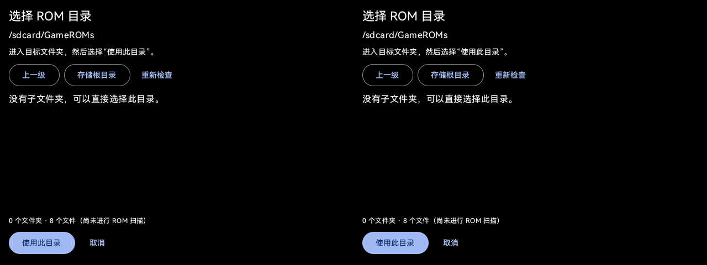

# In-app ROM directory selection — 2026-10-10

Version: `1.17.0-rayneo.3`. Package/signing identity and launcher name remain unchanged.

The old DocumentsUI fallback reused a fixed/previous path and immediately finished when permission was already granted. It therefore could not act as a folder chooser. The existing RayNeo storage screen now provides subfolder browsing, Up, Storage root, a readable path/count, and explicit **Use this directory** / Cancel actions. It retains the existing single-tree stereo host and focus input.

Directory listing is read-only and asynchronous. Navigating, returning from permission Settings, refreshing, and cancelling do not update preferences or start indexing. Explicit confirmation rechecks file permission and directory access, persists the local path, clears the SAF preference and schedules a single scan. Expired listing callbacks are discarded after pause, navigation or completion. The browser remains within shared storage and preserves existing ROM files.

On the user's X3 Pro, the page displayed `/sdcard/GameROMs` with 8 files in both eyes. The persisted preference is `/sdcard/GameROMs`; a read-only copy of the application database contains 8 game entries, all under `file:///sdcard/GameROMs/`. The owner confirmed the picker is working. No firmware, system IME or permission settings were changed; existing all-files authorization remained allowed. Boot ID was unchanged across installation and initial picker checks.

Validation: APK built and installed as a data-preserving update; 61 unit tests passed, including 5 new directory-browser checks, plus ktlint and Android lint. The previous source and app-data snapshot were retained locally.

Permission behavior: checks run when the directory page opens/resumes and again on confirmation. This release does not add automatic permission prompting at every app startup. After reflash or uninstall/reinstall, use the existing grant/retry flow or the documented ADB fallback if system Settings are unavailable.

APK SHA-256: `89cb213f0481cf4ef4c2662222914a32c42aa33fe6385f3c0209e58a12d2d663`.
