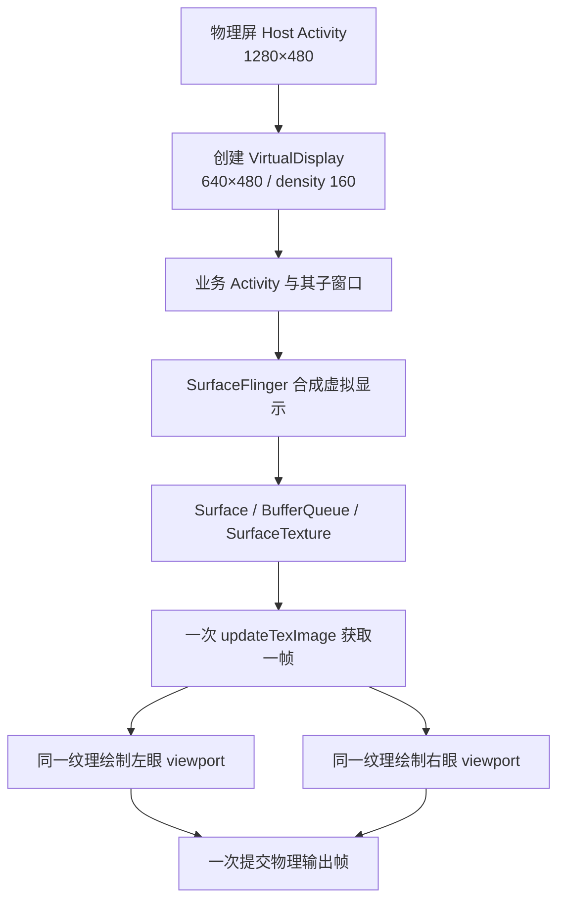

# 真正单眼逻辑显示的可行性分析

日期：2026-09-09。本文是完成本轮 Lemuroid 迁移后的设计分析；尚未创建虚拟显示原型，也未修改设备的显示配置或系统组件。

## 判断

有一条比逐个包装 View 更接近通用方案的路线：让业务 Activity 实际运行在 640×480 的 VirtualDisplay 上，取这个显示的完整合成画面，再在物理屏上用 GPU 同帧绘制到左右两个区域。

对有源码、能够调整入口和启动上下文的应用，这条路线值得做最小原型。对于未经改造的任意 APK，跨应用启动、嵌入、输入和系统窗口需要额外的平台能力，不能仅凭一个普通应用的 View 包装器推导出通用支持。

本轮对设备的只读检查确认：

- `android.software.activities_on_secondary_displays` 返回 `true`。
- 当前公开的内置显示模式只有 1280×480，约 60 Hz，density 160。
- 系统有标准 DisplayManager、SurfaceFlinger 与厂商显示配置服务；这些服务的存在没有证明厂商已提供可直接使用的双眼镜像接口。

这说明 Android 的多显示 Activity 能力具备了一个必要前提；还不是原型已经运行的证据。

## 为什么旧方案总会遗漏弹层

限制根 View 的宽度只改变该内容树的测量与绘制。Activity 所属的真实 display、WindowManager 的窗口边界、独立 Dialog/Popup 以及应用使用的资源上下文仍可能是物理屏尺寸。

Lemuroid 的帮助弹窗已经给出直接例子：背景首页被双绘制容器复制，单独的 Dialog 仍横跨两眼。本轮通过统一 Dialog 入口修复了这些已接入的窗口，见 [验证截图](2026-09-09-validation.md)。原来的适配草稿虽然提出了“让应用以为是 640×480”的目标，根 View 包装本身并未完成整个显示环境的切换。

修改 `screenWidthDp`、`DisplayMetrics.widthPixels` 或 `wm size` 中的某一个数值也不自动产生双眼输出。前两者可能让部分布局选择另一套资源；全局 `wm size` 会影响其他应用和系统 UI，输出依然需要明确的左右复制步骤。

## 建议的原型结构

Android 的 `DisplayManager.createVirtualDisplay()` 接受宽、高、密度和输出 Surface；虚拟显示的内容渲染到该 Surface。业务入口用 `ActivityOptions.setLaunchDisplayId()` 指向虚拟 display，并保持后续 Activity、Dialog/Popup 使用正确的 display/Activity context。[DisplayManager 文档](https://developer.android.com/reference/android/hardware/display/DisplayManager)、[Activity 启动策略](https://source.android.com/docs/core/display/multi_display/activity-launch)。

在 GPU 输出侧，用 SurfaceTexture 对接虚拟显示的合成输出。每个待显示的源帧只调用一次 `updateTexImage()`，读取其变换矩阵，在左右 viewport 采样同一纹理，最后提交一次物理帧。这一设计让两眼使用同一份已经取得的画面；无需为两眼运行两套页面、模拟器或解码器，也无需每帧做 Bitmap/CPU 回读。[SurfaceTexture 图形架构](https://source.android.com/docs/core/graphics/arch-st)。

性能收益目前是机制上的预期：可以统一普通 UI 与属于该 display 的独立 Surface，并消除当前左眼直接呈现、右眼另行 PixelCopy 的不同帧取样方式。但虚拟显示合成、缓冲队列、同步 fence 和最终 GPU 绘制仍有成本。是否比当前游戏路径更快，以及增加多少输入到显示延迟，需要设备测量。

## 三条路线的取舍

| 路线 | 主要覆盖面 | 代价与限制 |
|---|---|---|
| 根 View + 共用双眼弹层入口 | 已接入的普通 UI、Dialog；改动较小 | 新窗口要单独接入；独立 Surface 仍要处理 |
| 每个适配应用内集成 VirtualDisplay 容器 | 在其逻辑 display 内的 Activity、子窗口和可合成 Surface | 多显示生命周期、资源上下文、输入转发、额外合成成本需要验证 |
| 系统 WindowManager/SurfaceFlinger/HWC 级方案 | 最接近覆盖任意 APK 与系统窗口 | 需要厂商或系统集成、对应权限及版本适配；必须有独立恢复与验证方案 |

建议先验证第二条。它有机会形成一个可复用的容器模块，后续每个有源码应用只接入口和必要的生命周期/输入接口。第三条作为更广覆盖面的后续路线，单独调查厂商接口和平台能力。

## 原型必须回答的问题

1. **显示环境是否真的一致？** 在业务 Activity 内记录 displayId、WindowMetrics、DisplayMetrics、Configuration；同时检查 Application context 和显式访问默认 Display 的代码。Activity 处于 640×480 display 不保证错误使用全局资源的库也自动遵循它。
2. **窗口是否都属于虚拟显示？** 验证 Activity 跳转、帮助、设置列表、下拉菜单、Popup 和输入法。通过 Application context 发起的窗口或导航、已有 singleTask 实例、外部 Activity 可能落到另一个 display。
3. **Surface 是否进入完整画面？** 先用普通 View/Compose 与一个 GLSurfaceView/视频 Surface 的组合验证。安全窗口、受保护视频和硬件 overlay 的适用条件必须单独判断。
4. **输入与焦点如何到达业务窗口？** 把物理输入转换成单眼坐标仍只是第一步；还需把事件送到正确 display/window，并正确处理手柄、镜腿、Back、对话框焦点和输入法。没有依据时，不把应用内 `dispatchTouchEvent()` 当作跨窗口或跨应用输入方案。
5. **生命周期是否稳定？** Host 与业务 Activity 的多显示生命周期、独立游戏进程、熄屏、恢复和虚拟 Surface 重建都需验证。Mercury 的前台/后台管理也要以当前固件日志为准。
6. **性能是否达标？** 在同一测试内容下比较现有方案和容器方案的帧时间、丢帧、GPU/CPU 开销、队列积压及新增延迟。60 Hz 下一个显示周期约 16.67 ms，这只是预算参考，不是当前实测成绩。

先用自有代码的最小展示应用覆盖“普通页面 + Dialog/Popup + GL 内容”，再接入 Lemuroid。验收点是完整窗口均落在正确逻辑 display、双眼采用同一源帧、没有每帧 CPU 回读，以及可测量的延迟/帧时间。原型通过后再提取容器模块并更新适配 skill。

## 跨应用覆盖的边界

Android 对虚拟显示上的 Activity 启动和窗口添加有明确的所有权/嵌入限制；普通应用自己创建一个 display 并不自动得到承载任意其他应用的权限。系统组件和具备相应嵌入能力的调用者有不同条件。[AOSP Activity 启动限制](https://source.android.com/docs/core/display/multi_display/activity-launch)。

因此，“可复用到一系列有源码应用的适配模块”与“装一个壳就运行任意 APK”应分别验证。对于本次 Lemuroid，首先证明自身 Activity、游戏 Surface 与弹窗在同一虚拟显示中可用，才有足够依据继续扩大覆盖面。
